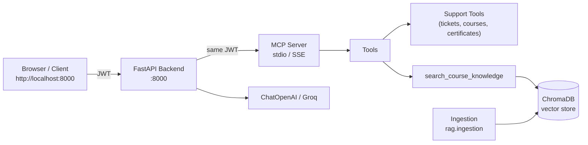
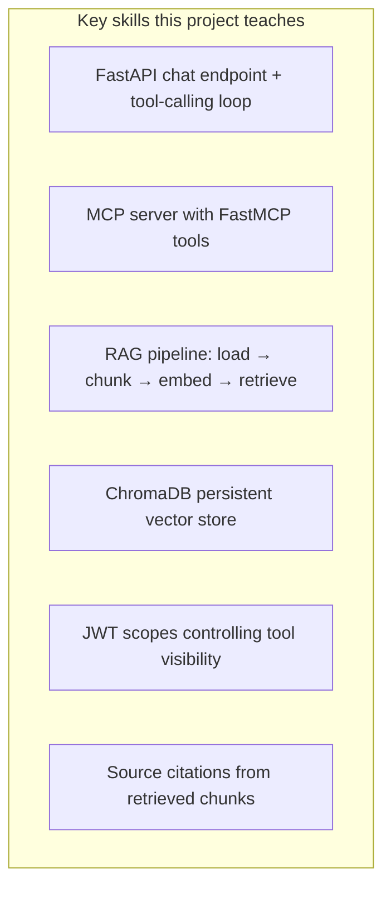

# RAG-Enhanced MCP Support Agent

Knowledge-augmented support agent that combines structured actions (tickets, courses, certificates) with retrieval over course documents, FAQs, and policies.

**Tech stack:** FastAPI + MCP (Model Context Protocol) + ChromaDB + RAG + LangChain + JWT roles/scopes

Built as an extension of the Telusko Support Chat (`project_mcp`).

## Architecture





## Folder Structure

```
.
├── backend/                  # FastAPI app (chat loop)
│   ├── app.py
│   └── mcp_client_example.py
├── mcp_server/               # MCP server
│   ├── server.py
│   └── tools/rag_tools.py
├── rag/                      # RAG pipeline
│   ├── embeddings.py
│   ├── vectorstore.py
│   ├── ingestion.py
│   └── retriever.py
├── knowledge/docs/           # Source documents (PDF, MD, TXT)
├── common/                   # config, auth, permissions (from project_mcp)
├── database/                 # SQLite models + schema
├── frontend/                 # Single-file HTML UI
├── pyproject.toml
├── .env.example
└── README.md
```

## Quick Start

```bash
# 1. Setup
uv sync
cp .env.example .env
# Edit .env: add OPENAI_API_KEY or GROQ_API_KEY

# 2. Ingest knowledge docs
uv run python -m rag.ingestion --path knowledge/docs

# 3. Run MCP server (stdio)
uv run python -m mcp_server.server

# 4. Run FastAPI backend
uv run python -m backend.app
```

Open http://localhost:8000

## What the agent can do

- Answer from the course knowledge base with source citations (RAG)
- Call structured support tools (tickets, courses, certificates)
- Respect role-based JWT scopes (learner / support / admin)

## Key Concepts

| Concept | Where it lives |
|---------|----------------|
| RAG retrieval | `rag/retriever.py` + `search_course_knowledge` MCP tool |
| Vector store | ChromaDB via `rag/vectorstore.py` |
| Document ingestion | `rag/ingestion.py` (PDF, Markdown, TXT) |
| MCP tool registration | `mcp_server/server.py` + `tools/rag_tools.py` |
| Chat endpoint | `backend/app.py` |
| Auth / scopes | Copy from your `project_mcp` into `common/` and `mcp_server/` |

## Next steps

1. Copy real support tools + JWT logic from `project_mcp` into this structure.
2. Add more documents to `knowledge/docs/`.
3. Wire a full MCP client into the FastAPI chat loop (see `backend/mcp_client_example.py`).
4. Add SSE transport for the MCP server if you want remote clients.

---

Related repos:  
- [project_mcp](https://github.com/yash9614/project_mcp) — base support chat  
- [genai-projects-lab](https://github.com/yash9614/genai-projects-lab) — RAG examples  
- [mcp-learning-path](https://github.com/yash9614/mcp-learning-path) — MCP concepts
